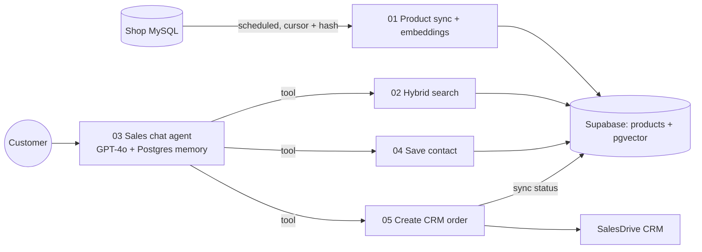

# AI Sales Assistant for an E-Commerce Store (n8n + Supabase + OpenAI)

A production chatbot I built for an online retailer (5,000+ products) as client work. It answers product questions from the real catalog, recommends products, captures leads and creates orders directly in the store's CRM.

Client names, domains and project IDs are anonymized. Credentials are not included.

## Architecture

## Workflows

| File | What it does |
|---|---|
| `01-product-sync-embeddings.json` | Scheduled sync of the product catalog from the shop database into Supabase. Batches with a cursor and stores a content hash per product, so embeddings are only regenerated when a product actually changes. Keeps OpenAI costs flat as the catalog grows. |
| `02-hybrid-search-tool.json` | Tool workflow: embeds the query (`text-embedding-3-small`) and calls a Supabase edge function that combines vector similarity and keyword search. Returns formatted results for the agent. |
| `03-sales-chat-agent.json` | The chat agent. Builds a dynamic system prompt depending on the product page the visitor is on and what is already known about the lead, keeps conversation memory in Postgres, logs product views and calls three tools. |
| `04-save-contact-tool.json` | Tool workflow: validates and stores name / email in the background without interrupting the conversation. |
| `05-create-crm-order-tool.json` | Tool workflow: validates the phone number, enriches the order with lead data and conversation context, creates the order in the CRM and writes the sync status back to Supabase. Includes a fallback upsert so no lead is lost if the CRM call fails. |

## Design decisions

- **Incremental embeddings** via content hashing instead of re-embedding the full catalog on every run.
- **Hybrid search** because product queries mix semantics ("grill for a small balcony") with exact terms (model names, prices).
- **Tools as separate workflows**, so each one is testable on its own and the agent stays small.
- **Strict prompt rules against hallucination**: specs and prices only from the database, otherwise hand over to a human manager.
- **Lead safety net**: every phone number ends up in the CRM or in Supabase with a pending status.

## Stack

n8n, OpenAI (GPT-4o, text-embedding-3-small), Supabase (Postgres, pgvector, edge functions), MySQL, REST / webhooks, SalesDrive CRM.

## Run it yourself

1. Import the JSON files into n8n.
2. Create credentials for OpenAI, Supabase, Postgres, MySQL and the CRM header auth, and assign them to the nodes marked `REPLACE_ME`.
3. Replace `YOUR_PROJECT` / `YOUR_ACCOUNT` in the HTTP nodes and link the tool workflows in `03` (`REPLACE_WITH_WORKFLOW_ID`).
4. Set the env variable `SALESDRIVE_FORM_KEY`.
